### 🚀 Sobre mí

- 🐍 **Python:** desarrollo de APIs con FastAPI, scripts y automatización.
- 🧪 **QA y automatización:** pruebas E2E con Playwright y Selenium, validación de APIs REST.
- ⚙️ **DevOps:** Docker, CI/CD con GitHub Actions, Nginx, PM2 y servidores Linux en AWS EC2.
- 🌐 **IT y redes:** soporte técnico, administración de redes y mantenimiento de equipos.
- 🤖 **MCP e IA:** conecto IAs con herramientas locales.

<b>🇬🇧 Click for English</b>

 

- 🐍 **Python:** API development with FastAPI, scripting and automation.
- 🧪 **QA & automation:** E2E testing with Playwright and Selenium, REST API validation.
- ⚙️ **DevOps:** Docker, CI/CD with GitHub Actions, Nginx, PM2 and Linux servers on AWS EC2.
- 🌐 **IT & networking:** technical support, network administration and hardware maintenance.
- 🤖 **MCP & AI:** connecting AIs to local tools.

### 🛠️ Tech Stack

### 🌟 Proyectos

<table>
<tr>
<td width="33%" valign="top">

**🤖 [AstraBots](https://astrabots.pro)**
Bots de WhatsApp gratis, con API Baileys u oficial de Meta.

</td>
<td width="33%" valign="top">

**🌉 [Web MCP Bridge](https://github.com/AstraxOf/web-mcp-bridge)**
Usa tus servidores MCP locales con ChatGPT, Gemini, Claude y DeepSeek.

</td>
<td width="33%" valign="top">

**🐍 [astrax-mcp](https://github.com/AstraxOf/astrax-mcp)**
SDK en Python para crear servidores MCP.

</td>
</tr>
</table>

### 📊 GitHub

